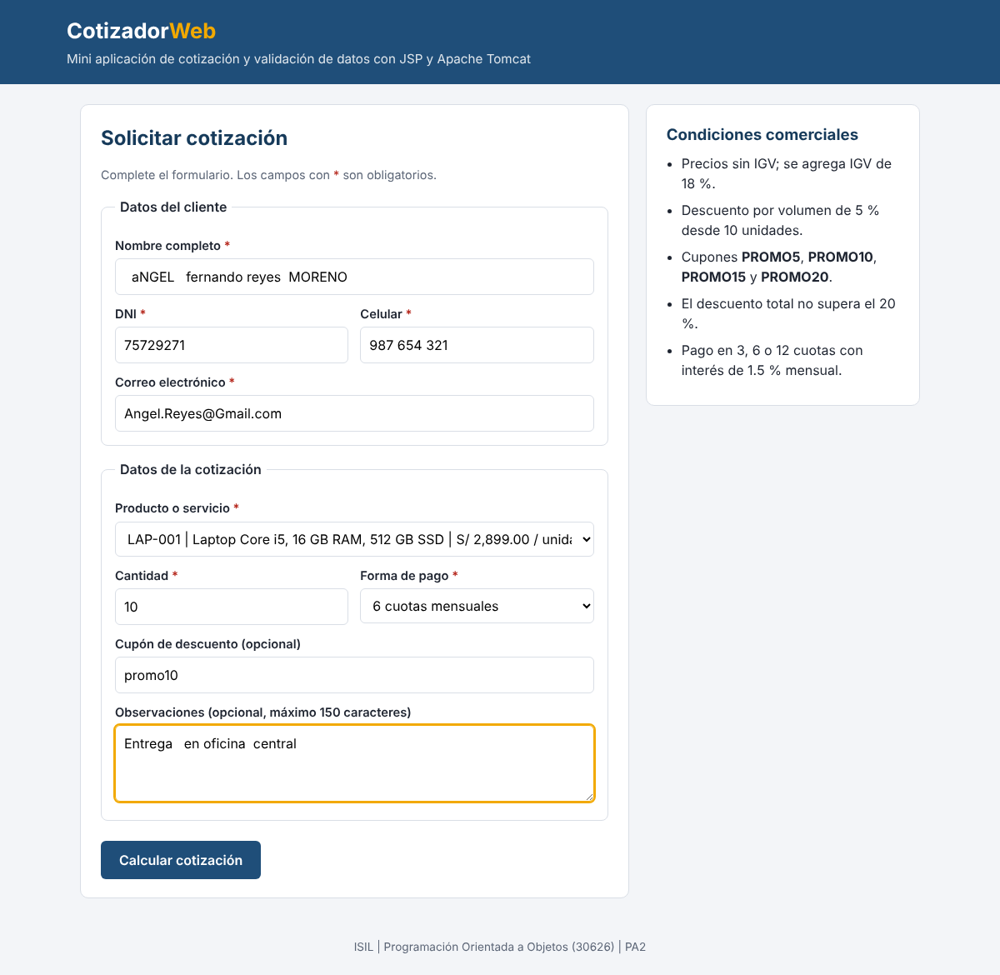
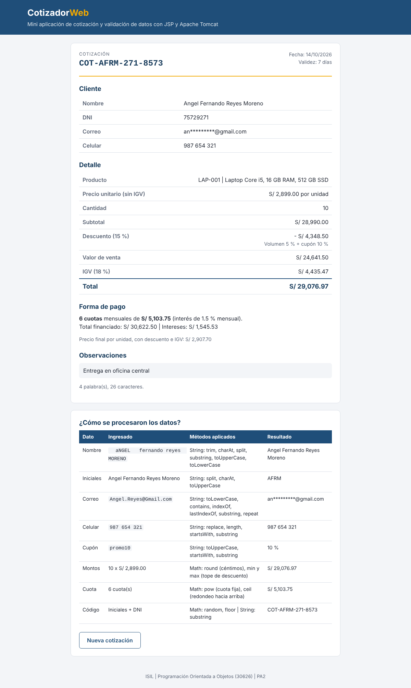
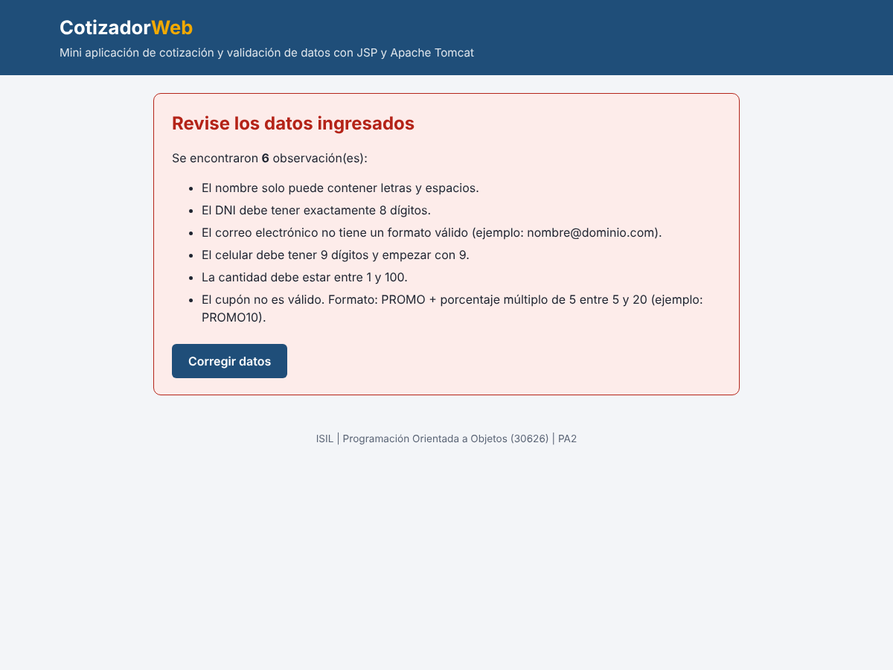
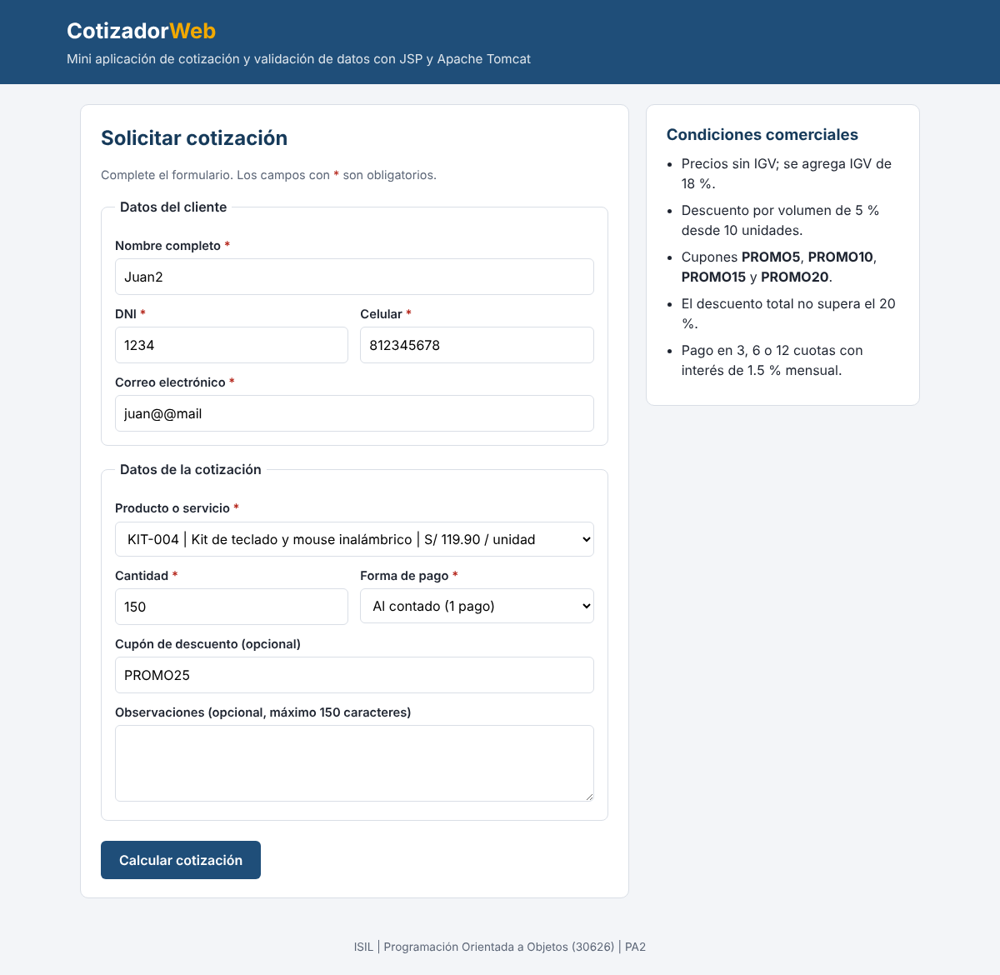
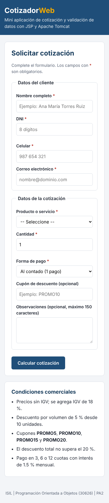

# PA2 | Cotizador Web con JSP y Apache Tomcat

Mini aplicación web de **cotización y validación de datos** desarrollada para la evaluación PA2 del curso **Programación Orientada a Objetos (30626)** de ISIL. Cubre los temas de las sesiones 5 a 7: proyecto web con JSP y Apache Tomcat, métodos de la clase `Math` y métodos de la clase `String`.

## Información

| | |
|---|---|
| **Institución** | ISIL |
| **Curso** | Programación Orientada a Objetos (30626) |
| **Docente** | Wilder Julio Espinoza Bravo |
| **Evaluación** | PA2 (sesiones 5, 6 y 7) |

## Video de exposición

🎥 **YouTube:** _pendiente (pegar aquí el enlace del video)_

## Integrantes y responsabilidades

| Integrante | Parte del caso que resuelve |
|---|---|
| **César Augusto Maguiña Robles** | Creación del proyecto Maven con Apache Tomcat, vistas JSP (`index.jsp`, `resultado.jsp`, fragmentos de encabezado y pie), hoja de estilos y flujo de datos entrada → procesamiento → salida. |
| **Angel Fernando Reyes Moreno** | Clases de lógica: `ProCadenas` (String), `ProAritmetica` (Math), `ValidadorDatos`, modelo (`Cliente`, `Producto`, `Catalogo`, `Cotizacion`), pruebas por consola (`PruebasCotizador`) y documentación. |

---

## Descripción de la solución

Una organización que vende equipos de cómputo y servicios de soporte necesita que sus clientes puedan pedir una cotización desde la web. La aplicación:

1. **Recibe datos por formulario** (`index.jsp`): nombre, DNI, correo, celular, producto, cantidad, forma de pago, cupón y observaciones.
2. **Valida y transforma los textos con `String`**: limpia espacios, pone el nombre en formato título, valida DNI, celular, correo y cupón, oculta el correo y escapa el HTML para mostrar los datos de forma segura.
3. **Calcula la cotización con `Math`**: subtotal, descuento por volumen y por cupón con tope, IGV, total y cuotas mensuales con interés.
4. **Muestra el resultado** (`resultado.jsp`): la cotización con su código único, o la lista de errores con un botón para volver al formulario **sin perder los datos ingresados**.

### Flujo de datos

```
 index.jsp (ENTRADA)          resultado.jsp (PROCESAMIENTO)                     resultado.jsp (SALIDA)
 ┌──────────────────┐  POST   ┌───────────────────────────────────────────┐    ┌───────────────────────────┐
 │ Formulario HTML  │ ──────▶ │ request.getParameter(...)                 │    │ Cotización con código,    │
 │ datos cliente    │         │ ValidadorDatos.validar(...)  ── String ─┐ │ ─▶ │ montos y cuotas           │
 │ producto, cuotas │         │ new Cliente(...)             ── String  │ │    │   ó                       │
 │ cupón            │ ◀────── │ new Cotizacion(...)          ── Math  ──┘ │    │ Lista de errores +        │
 └──────────────────┘ corregir└───────────────────────────────────────────┘    │ botón "Corregir datos"    │
                                                                               └───────────────────────────┘
```

### Reglas del negocio

| Regla | Valor |
|---|---|
| IGV | 18 % sobre el valor de venta |
| Descuento por volumen | 5 % desde 10 unidades |
| Cupones válidos | `PROMO5`, `PROMO10`, `PROMO15`, `PROMO20` (sin distinguir mayúsculas) |
| Tope de descuento | 20 % (volumen + cupón) |
| Formas de pago | Al contado, o 3, 6 o 12 cuotas con interés de 1.5 % mensual |
| Cantidad | Entre 1 y 100 |

### Uso de la clase `Math` (Sesión 6)

| Método | Dónde | Para qué |
|---|---|---|
| `Math.round` | `ProAritmetica.redondear` | Redondear montos a céntimos |
| `Math.ceil` | `ProAritmetica.redondearArriba` | Redondear la cuota hacia arriba para no cobrar de menos |
| `Math.pow` | `ProAritmetica.cuotaFija` | Cuota fija: `monto * i / (1 - (1 + i)^-n)` |
| `Math.min`, `Math.max` | `ProAritmetica.limitar`, `Cotizacion` | Aplicar el tope de 20 % al descuento y evitar intereses negativos |
| `Math.random`, `Math.floor` | `ProAritmetica.numeroAleatorio` | Parte aleatoria del código de cotización |
| `Math.abs` | `ProAritmetica.diferencia` | Diferencia absoluta entre montos |

### Uso de la clase `String` (Sesión 7)

| Método | Dónde | Para qué |
|---|---|---|
| `trim`, `charAt`, `isEmpty` | `ProCadenas.normalizarEspacios`, `estaVacia` | Quitar espacios sobrantes y detectar campos vacíos |
| `split`, `substring`, `toUpperCase`, `toLowerCase`, `join` | `ProCadenas.capitalizarPalabras` | `"aNGEL   reyes"` → `"Angel Reyes"` |
| `charAt` | `ProCadenas.obtenerIniciales`, `esNumerico`, `cuentaOcurrenciasCaracter` | Iniciales, validar dígitos y contar arrobas |
| `contains`, `indexOf`, `lastIndexOf`, `endsWith` | `ProCadenas.esCorreoValido` | Validar el formato del correo |
| `substring`, `repeat` | `ProCadenas.enmascararCorreo` | `angel@gmail.com` → `an***@gmail.com` |
| `replace` | `ProCadenas.quitarEspacios`, `escaparHtml` | Limpiar el celular y evitar que se inyecte HTML |
| `startsWith`, `length` | `ValidadorDatos` | Celular que empieza con 9 y tiene 9 dígitos, cupón `PROMO` |
| `equals`, `equalsIgnoreCase` | `Catalogo.buscar`, `index.jsp` | Buscar el producto y mantener la opción seleccionada |
| `String.format` | `resultado.jsp` | Formato de moneda `S/ 1,234.56` |

## Estructura del proyecto

```
curso-poo/
├── pom.xml
├── README.md
├── docs/
│   ├── PRUEBAS.md                 # casos de prueba y resultados
│   ├── GUION_VIDEO.md             # guion de la exposición
│   └── evidencias/                # capturas de la aplicación funcionando
└── src/main/
    ├── java/pe/isil/poo/cotizador/
    │   ├── modelo/
    │   │   ├── Producto.java      # producto o servicio
    │   │   ├── Catalogo.java      # lista fija de productos
    │   │   ├── Cliente.java       # datos del cliente normalizados
    │   │   └── Cotizacion.java    # cálculo de montos y cuotas (Math)
    │   ├── util/
    │   │   ├── ProCadenas.java    # métodos utilitarios con String
    │   │   ├── ProAritmetica.java # métodos utilitarios con Math
    │   │   └── ValidadorDatos.java# validación de los campos del formulario
    │   └── pruebas/
    │       └── PruebasCotizador.java # pruebas por consola (método main)
    └── webapp/
        ├── index.jsp              # ENTRADA: formulario
        ├── resultado.jsp          # PROCESAMIENTO y SALIDA
        ├── css/estilos.css
        └── WEB-INF/jspf/          # encabezado y pie incluidos con <%@ include %>
```

## Instrucciones de ejecución

### Requisitos

* **JDK 21** o superior (`java -version`).
* **Apache Tomcat 11** (también funciona en Tomcat 10.1).
* **IntelliJ IDEA** o **Apache NetBeans** con soporte para Maven.

### Opción 1: generar el WAR y desplegarlo en Tomcat

1. Abrir el proyecto en el IDE (es un proyecto Maven, se reconoce por el `pom.xml`).
2. Ejecutar `clean` y luego `package` (en IntelliJ: panel **Maven** → **Lifecycle**; por consola: `mvn clean package`).
3. Copiar `target/CotizadorWeb.war` a la carpeta `webapps/` de Tomcat.
4. Iniciar Tomcat con `bin/startup.bat` (Windows) o `bin/startup.sh` (Linux/Mac).
5. Abrir en el navegador: **http://localhost:8080/CotizadorWeb/**

### Opción 2: ejecutar desde el IDE

* **NetBeans:** clic derecho en el proyecto → **Properties** → **Run** → elegir el servidor Apache Tomcat → **Run**.
* **IntelliJ IDEA Ultimate:** **Run** → **Edit Configurations** → **+** → **Tomcat Server** → **Local**, en la pestaña **Deployment** agregar el artefacto `CotizadorWeb:war exploded` y ejecutar.

### Datos de prueba sugeridos

| Campo | Valor |
|---|---|
| Nombre | `  aNGEL   fernando reyes  MORENO` (se normaliza solo) |
| DNI | `75729271` |
| Celular | `987 654 321` |
| Correo | `Angel.Reyes@Gmail.com` |
| Producto | `LAP-001` Laptop |
| Cantidad | `10` |
| Forma de pago | 6 cuotas |
| Cupón | `promo10` |

Resultado esperado: descuento 15 %, total **S/ 29,076.97**, 6 cuotas de **S/ 5,103.75**.

### Pruebas por consola

La clase `pe.isil.poo.cotizador.pruebas.PruebasCotizador` tiene un método `main` que verifica 46 casos de las clases `ProCadenas`, `ProAritmetica`, `ValidadorDatos` y `Cotizacion`. Se ejecuta con clic derecho → **Run**. Resultado obtenido: **46 correctas, 0 fallidas**. El detalle de los casos está en [`docs/PRUEBAS.md`](docs/PRUEBAS.md).

## Evidencias

| Formulario | Cotización calculada |
|---|---|
|  |  |

| Validaciones | Corregir sin perder datos | Vista móvil |
|---|---|---|
|  |  |  |

## Decisiones técnicas

* **La lógica va en clases Java y no dentro del JSP.** Las páginas JSP solo leen parámetros, llaman a las clases y muestran resultados. Así cada clase se puede probar por separado con `PruebasCotizador` y el código es más fácil de explicar.
* **Clases utilitarias con métodos estáticos** (`ProCadenas`, `ProAritmetica`), siguiendo el modelo de las clases vistas en las sesiones 6 y 7.
* **Se valida en el servidor**, aunque el formulario tenga `required` y `min`/`max`, porque esas restricciones del navegador se pueden saltar.
* **Se escapan los textos con `replace`** antes de mostrarlos, para que un texto como `<script>` se vea como texto y no se ejecute.
* **Montos redondeados a céntimos con `Math.round`** y la cuota redondeada hacia arriba con `Math.ceil`, para que la suma de cuotas nunca quede por debajo del total.
* **`request.setCharacterEncoding("UTF-8")`** para que nombres con tildes y ñ (por ejemplo, *Muñoz Peña*) lleguen bien.
